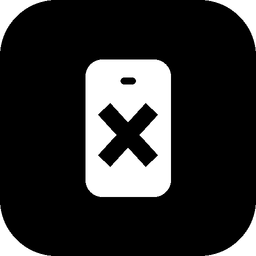
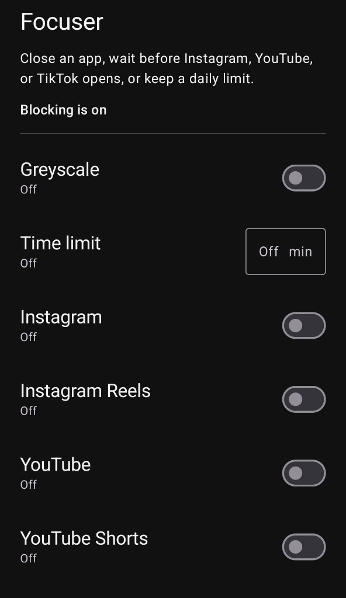

# Focuser

<p align="center">
  
</p>

<p align="center">
  
</p>

Focuser is a small Android app. It gets in the way when Instagram, YouTube, or TikTok is about to eat the evening. Nothing here is clever. The app closes things, waits a few seconds, turns the screen grey, and keeps a count of minutes. Those are the moves that experiments have actually measured. A dashboard that only tells you how long you scrolled is not one of them.

You turn each piece on only when you want it. With everything off, the apps open as usual. The pause at the door still appears for Instagram, YouTube, and TikTok, because that pause is part of opening those apps rather than a switch on this screen.

## What you can switch on

**Greyscale** turns the whole screen grey while Instagram or YouTube is in front, status bar included. Color comes back when you leave, and also if Focuser itself is stopped. The phone has no way for one app to recolor only another app's window, so this uses the system color filter and it covers everything you can see until you leave. If the row says it needs setup, the switch will not change the colors yet.

**Time limit** is a number of minutes for the calendar day. Instagram, YouTube, and TikTok each keep their own count. The usual browsers share one count, so time in Chrome and time in Firefox come out of the same pile. Only time on screen counts. The clock pauses when you leave and when the screen turns off, and it does not start over when you come back. When the minutes for that app run out, Focuser sends you home and keeps sending you home until the next day. There is no button to ignore it for today. A number you type in is stored for tomorrow. Today keeps the limit that is already in place, so you cannot raise the cap in the moment to get more time.

**Instagram** closes Instagram the moment it opens. The pause screen is skipped.

**Instagram Reels** closes Instagram when a reel is on screen. That includes a reel you open from search. It does not treat the ordinary home feed as Reels just because Instagram keeps the Reels page loaded in the background.

**YouTube** closes YouTube the moment it opens. The pause screen is skipped.

**YouTube Shorts** closes YouTube when Shorts is on screen. That includes a short you open from the shelf on the home page, even while the Home tab still looks selected.

## The pause before those apps open

Instagram, YouTube, and TikTok stop you on a black screen. You pick 5, 10, 15, or 30 minutes, wait 6 seconds, then continue or close. Close sends you home. Continue starts that session.

If the daily limit is on, the choices shrink to what you have left. Under a minute left, the app closes instead of offering a tiny session.

When the session you picked runs out, the black screen comes back. Staying longer means picking another length and holding the button for 2 seconds. That hold is there so extending is a small effort, not a tap you can do without looking.

Reels and Shorts still close the app after you get in, if those switches are on.

## How the app actually does this

Focuser is an accessibility service. Android lets that service see which app is in front, read the names of things on screen, and send you to the phone's home screen. It does not log in to Instagram or YouTube, and it does not read your messages. The service is told to watch only Instagram, YouTube, the TikTok packages, and a list of browsers. Other apps are ignored.

The pause screen is drawn by the service on top of the app you just opened. It is not a page inside Instagram. While it is up, the clock does not move. After you continue, Focuser checks about twice a second and adds the time since the last check, as long as that gap is under 15 seconds. A long gap is treated as time you were not looking, so it is not added.

The daily totals live in the app's own storage, with the date. At midnight the counts go back to zero and tomorrow's limit, if you typed a new one, becomes today's limit. Three TikTok package names share one total, because the same app is published under more than one name. These browsers share the other total: Chrome, Firefox, Firefox Focus, Edge, Samsung Internet, Brave, Opera, DuckDuckGo, Vivaldi, Kiwi, Via, and the plain Android browser.

Greyscale writes two system settings while Instagram or YouTube is in front. One turns the color filter on. The other sets that filter to grey. The previous values are saved and written back when you leave. Android only allows this write from an app that has been granted `WRITE_SECURE_SETTINGS`. A normal install cannot grant that to itself, which is why the computer command exists. The grant lasts until you uninstall Focuser.

Reels is recognized from Instagram's own screen names: the Reels tab, or the reel viewer. If the Home tab is the one selected, a leftover reel viewer is ignored. Shorts is recognized from the Shorts tab, or from the short player itself. The player check is what catches a short opened from the home shelf, where the Home tab stays selected.

Closing an app is the same action as pressing Home. Focuser does not press Back. On Instagram, Back from Reels used to dump you on the phone's app drawer.

## What you see, and the Android tool behind it

An accessibility service is a listener you turn on under Settings, Accessibility. Android then lets that app notice another app, read the names of things on its screen, draw over it, and press Home. Greyscale is a different tool: the system color filter.

| What you see | The Android tool behind it |
| --- | --- |
| The app knows Instagram or YouTube just opened | Accessibility event `typeWindowStateChanged`, then `rootInActiveWindow`. The event fires when the front window changes and names the app in front. |
| Reels or Shorts closes the app, but the home feed does not | `findAccessibilityNodeInfosByViewId` on the screen tree. That reads the names of buttons and panels, such as the Reels tab or the Shorts player. It does not log in or read your messages. |
| The app is sent home | `performGlobalAction(GLOBAL_ACTION_HOME)`. That is the same action as pressing the Home button. It does not press Back. |
| The black pause screen | Window type `TYPE_ACCESSIBILITY_OVERLAY`. The service draws its own full screen window on top of the app you just opened. That window is not a page inside Instagram. |
| The minute count | A timer in the service, plus `PowerManager.isInteractive`. Time is added only while one of those apps is on screen and the screen is on. |
| The screen goes grey on Instagram or YouTube | `Settings.Secure` keys `accessibility_display_daltonizer` (mode 0) and `accessibility_display_daltonizer_enabled`. This is Android color correction. The write needs `WRITE_SECURE_SETTINGS`, granted once from a computer. |
| Today's minutes stay until midnight | `SharedPreferences`. Private storage for this app. The date is stored with the totals, and a new minute number waits until the next day. |
| Other apps are left alone | `packageNames` on the service. Android only sends events for the packages listed there. |

## What the research actually tested

These papers were opened and checked before they were listed here. The app follows the shape of the results. It is not a copy of any study, and none of these trials was run on Focuser.

**A limit you set for later, and cannot talk yourself out of.** Hunt Allcott, Matthew Gentzkow, and Lena Song ran a randomized experiment in which people could set limits on future screen time. The National Bureau of Economic Research copy is [Digital Addiction](https://www.nber.org/papers/w28936), working paper 28936 (2021), later published in the American Economic Review in 2022. The paper's own summary says that letting people set those future limits substantially reduced use, which the authors read as a self control problem. A limit you can raise today would miss that point, so Focuser keeps today's number fixed until midnight.

The soft version of a limit does less. Laura Zimmermann and Michael Sobolev compared grayscale, self set time limits, and tracking alone with 112 students. Their paper is [Digital Strategies for Screen Time Reduction: A Randomized Field Experiment](https://doi.org/10.1089/cyber.2022.0027), Cyberpsychology, Behavior, and Social Networking (2023). The time limits, which people could still extend or remove, were not clearly lower than tracking alone (about 270 minutes a day versus 283). People also said they passed their limits about half the time. Focuser's daily close has no ignore button for that reason.

**A few seconds at the door, and a session length you name first.** The Danish Competition and Consumer Authority ran a randomized field experiment with 269 people aged 13 to 17, using the app one sec. The public report is [Disrupting Social Media Habits](https://en.kfst.dk/analyses/2025/20250619-disrupting-social-media-habits-a-field-experiment-with-young-danish-consumers) (19 June 2025), with the [full pdf](https://en.kfst.dk/media/5t4dscjt/20250619-disrupting-social-media-habits.pdf). Waiting 6 seconds before a social app opened cut daily social media activity by 36 percent. Asking for a session length, then making people do a small effort to get more time, cut it by 31 percent. A screen that only asked them to reflect did almost nothing. The cut showed up right away and held for the four weeks of the intervention. Satisfaction with social media did not fall. This sample is teenagers, paid with gift cards, so it is not a portrait of every adult. Focuser uses the same 6 second wait. The extra time is a 2 second hold rather than the effort task in that study, which could be something like turning the phone over.

David J. Grüning, Frederik Riedel, and Philipp Lorenz-Spreen tested one sec with 280 people over 6 weeks, plus a separate online experiment with 500 people. The paper is [Directing smartphone use through the self-nudge app one sec](https://doi.org/10.1073/pnas.2213114120), Proceedings of the National Academy of Sciences, 16 February 2023. About 36 percent of open attempts were dismissed. In the online experiment, the button that abandons the open did the most, the delay also reduced watching, and a sentence asking people to think about it did not. One author built the app, and the field part had no untreated comparison group, so the famous "57 percent fewer opens" line is a weaker number than the 36 percent. Focuser keeps the wait and the close button, and it does not ask you why you are opening the app.

**Grey while the phone is in use.** Zimmermann and Sobolev, in the paper linked above, found grayscale at about 233 minutes a day against 283 minutes for people who only tracked their use. That is about 50 minutes, even though the filter was not on the whole time. Life satisfaction, stress, sleep, happiness, and grades did not differ. Before the study, students expected grayscale to be the least useful option and a usage display to be the best. The results went the other way.

Cynthia A. Dekker and Susanne E. Baumgartner tracked 84 Android users for two weeks and then turned the phone grey for one week. The paper is [Is life brighter when your phone is not?](https://journals.sagepub.com/doi/10.1177/20501579231212062), Mobile Media and Communication, first published online 9 November 2023. Screen time fell by about 20 minutes a day. The number of times people unlocked the phone did not change. Felt control improved and stress fell. Productivity and sleep quality did not. About a third of the people said they would never use grayscale. It is annoying, and it still shortens sessions that have already started.

Alex J. Holte and F. Richard Ferraro put college phones into grayscale for 8 to 10 days. The paper is [True colors: Grayscale setting reduces screen time in college students](https://doi.org/10.1080/03623319.2020.1737461), The Social Science Journal, published online 3 April 2020, volume 60, number 2, pages 274 to 290. Total screen time fell by about 38 minutes a day. Social media and web browsing fell. Video time did not. Anxiety and depression improved in the comparison group too, so the mood change cannot be credited to the grey screen. Focuser greys the screen only while Instagram or YouTube is open. These studies greyed the whole phone, all day. That is a real difference, and the video result is a reason not to expect YouTube itself to shrink just because the picture has no color.

**Closing an app outright.** Hunt Allcott, Luca Braghieri, Sarah Eichmeyer, and Matthew Gentzkow paid a sample of people to deactivate Facebook for the four weeks before the 2018 United States midterm election. The paper is [The Welfare Effects of Social Media](https://www.aeaweb.org/articles?id=10.1257/aer.20190658), American Economic Review, volume 110, number 3 (March 2020), pages 629 to 676. Deactivation reduced online activity, raised subjective wellbeing a little, reduced news knowledge, and left people using Facebook less even after the four weeks. That is evidence about leaving the whole app, for people who were paid to do it. It is the reason a full Instagram or YouTube switch exists. It is not evidence about closing only the Reels tab or only the Shorts player. No field trial that turned up for this app isolates those two surfaces. If the session you care about is the reel, the close is doing the same job as closing the app. If you can keep scrolling somewhere else, the minutes move.

## What these papers do not say

Cutting tens of minutes has usually left depression, anxiety, sleep, and life satisfaction about where they were. The Facebook deactivation above is one of the clearer exceptions, and it was a paid, four week absence, not a grey filter. Grayscale studies in particular cut minutes without a reliable mood change.

Nothing here shows that a chart of your screen time, a motivational quote, or a streak will shorten a session. Zimmermann and Sobolev's tracking group did not use the phone less, even though students had expected that display to work best.

The papers also stop when the tool stops. People use the apps more again on the days the gate is off. Focuser does not claim to change the habit after you turn it off.

## How to put it on the phone

Install the app, then open Android settings and turn Focuser on under Accessibility. Until that switch is on, none of the closing, waiting, or counting can run.

For greyscale, connect the phone to a computer and run this once:

```
adb shell pm grant com.vizeno.focuser android.permission.WRITE_SECURE_SETTINGS
```

Open Focuser again after that. The greyscale row should stop asking for setup. You can turn wireless debugging off. The permission stays until the app is uninstalled.

## Prompt to build this app

You need Android Studio, Kotlin, and Jetpack Compose. The phone should be Android 8 or newer. Turn the finished app on under Settings, Accessibility. Grey also needs this once from a computer: `adb shell pm grant com.vizeno.focuser android.permission.WRITE_SECURE_SETTINGS`.

Copy the block below to a coding agent.

```text
Build a personal Android app named Focuser in Kotlin and Jetpack Compose. Simple black and white switches. No accounts, no AI, no usage dashboard. For each row, use the Android tool in the second column and no other approach.

What you see | The Android tool behind it
The app knows Instagram or YouTube just opened | Accessibility event typeWindowStateChanged, then rootInActiveWindow. The event fires when the front window changes and names the app in front.
Reels or Shorts closes the app, but the home feed does not | findAccessibilityNodeInfosByViewId on the screen tree. That reads the names of buttons and panels, such as the Reels tab or the Shorts player. It does not log in or read messages.
The app is sent home | performGlobalAction(GLOBAL_ACTION_HOME). Same action as the Home button. Do not press Back.
The black pause screen | Window type TYPE_ACCESSIBILITY_OVERLAY. Draw a full screen window on top of the app that just opened. It is not a page inside that app.
The minute count | A timer in the service, plus PowerManager.isInteractive. Add time only while a watched app is on screen and the screen is on.
The screen goes grey on Instagram or YouTube | Settings.Secure keys accessibility_display_daltonizer (mode 0) and accessibility_display_daltonizer_enabled. This is Android color correction. The write needs WRITE_SECURE_SETTINGS.
Today's minutes stay until midnight | SharedPreferences. Store the date with the totals. A new minute number waits until the next day.
Other apps are left alone | packageNames on the accessibility service. Android only sends events for the packages listed there.

Switches: greyscale, daily minutes, block Instagram, block Reels, block YouTube, block Shorts. Reels and Shorts default on. The others default off. Instagram, YouTube, and TikTok open onto a black screen: pick 5, 10, 15, or 30 minutes, wait 6 seconds, then Close or Continue. Extending holds Continue for 2 seconds. Whole app switches skip that screen and go home immediately. One minute number, separate daily clocks for Instagram, YouTube, TikTok, and browsers. TikTok package names share one clock. Browsers share one clock. Time adds up until local midnight. Closing and reopening does not reset it. There is no skip for today.
```
